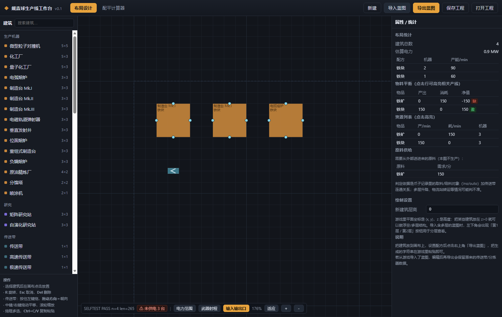
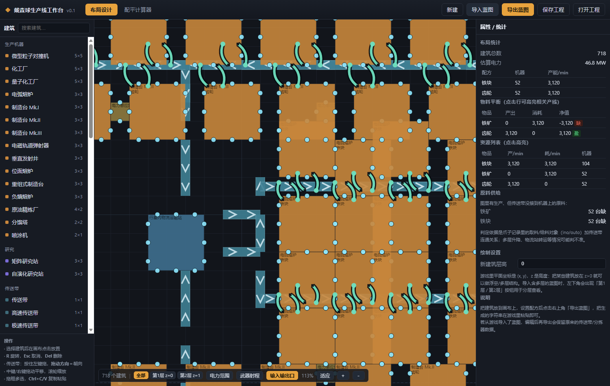
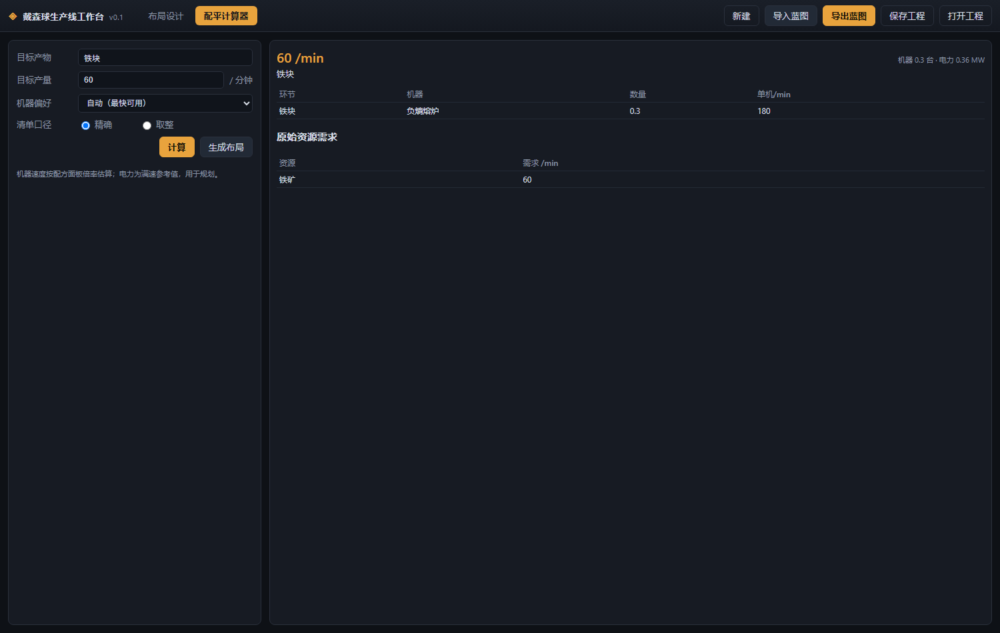
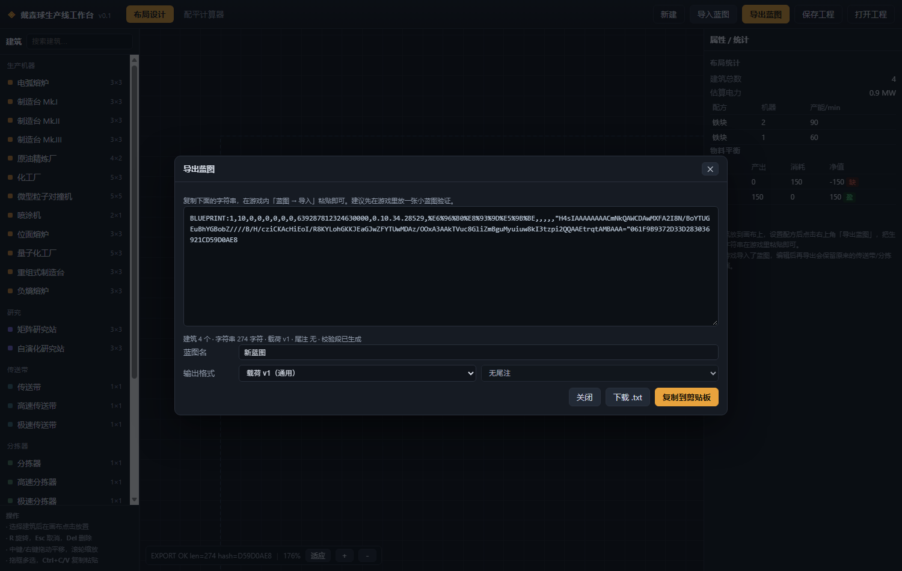
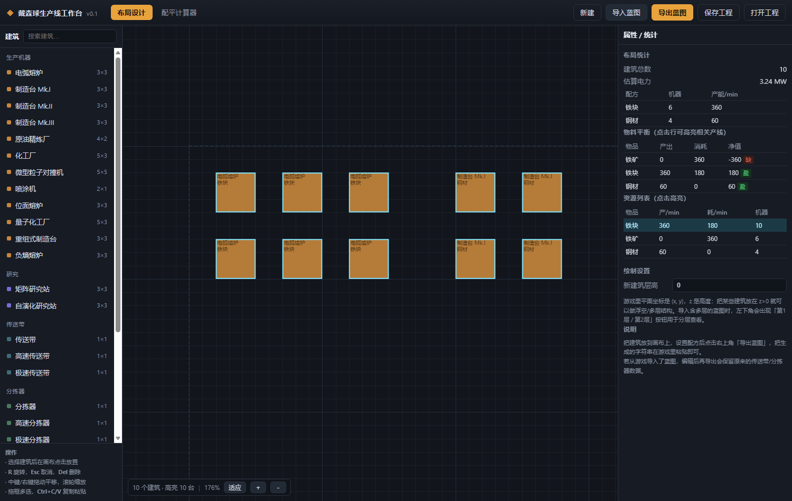

# dsp-eda · 戴森球产线工作台

> Dyson Sphere Program 的产线 EDA —— 像画板子一样画产线：布局、配平、蓝图三合一。

[](LICENSE)
[](package.json)

一个纯前端的《戴森球计划》产线设计与蓝图工具：网格布局编辑器 + 配平计算器 + 蓝图导入导出。
不需要安装、不需要联网，双击 `index.html` 即可使用（Chrome / Edge 等 Chromium 内核浏览器）。

仓库：<https://github.com/15635953102-debug/dsp-eda>



## 功能

**布局设计**
- 左侧建筑面板按分类列出**全部 61 种建筑**（生产机器、研究站、传送带、分拣器、物流、电力、采集、防御），显示占地与速度；搜索框可按名字过滤。
- 画布：网格吸附放置、旋转（`R`）、框选、拖动移动、删除（`Del`）、复制粘贴（`Ctrl+C/V`）、撤销重做（`Ctrl+Z/Y`）、滚轮缩放、右键/中键平移、`Esc` 取消放置与高亮。
- **走线（W）**：参考 EDA 的走线手感——**走线 = 传送带，元件 = 建筑物**。按住左键拖，按曼哈顿路径自动连铺，**拐弯自动成型**（转弯画成圆角、方向随路径改变）；单击放一节。方向永远跟着拖动方向走。
- **网络高亮**：只选中一条传送带时，自动点亮**整条相连的产线**（带子 + 贴着它的建筑）；再点一次或 `Esc` 取消。
- **检查（X / 右上角「检查」）**：设计规则检查，结果在右侧「检查结果（DRC）」，点任意一行高亮对应问题：
  - 断头带子（四周没带子也没爪子接）、爪子过长（>2 格速度掉一半）、未供电、缺料（没接通或本图不产）。
- **快捷键**：`W` 走线 · `S` 选择 · `E` 删除 · `X` 检查 · `F` 适应视图 · `R` 旋转 · `Esc` 取消 · `Del` 删除选中。
- **带面走格子中线**：横带、竖带共用同一套格子（朝向由 `yaw` 决定），所以拐弯处能严丝合缝；直带看起来仍是一条细带子 + 箭头。
- **怎么放**：点一下在光标所在格放一节（朝向按 `R` 或沿用旁边带子）；按住拖按路径连铺；放置前有绿色预览＝最终位置。
- **反向的带子不会连通**：两条带子"脸对脸"（方向相反、正对着）在游戏里接不上，工具在流动分析里也按不连通处理。
- **端口数量按建筑类型**：不再是"每格一个口"。机器类的口数取自游戏数据里的 `inserterBorder`，沿边均匀分布、居中对齐：

  | 建筑 | 上/下 | 左/右 | 合计 |
  | --- | --- | --- | --- |
  | 熔炉 / 制造台 / 精炼厂 / 位面·负熵熔炉 / 重组式 | 1 / 1 | 1 / 1 | 4 |
  | 化工厂 / 量子化工厂 | 2 / 1 | 1 / 1 | 5 |
  | 微型粒子对撞机 / 研究站 | 2 / 2 | 2 / 2 | 8 |
  | 物流运输站 / 仓储 / 分流器 / 采矿机等无限制建筑 | 每格一个 | 每格一个 | w×2+h×2 |
  | 传送带 / 分拣器 / 喷涂机 | 0 | 0 | 0 |

  左右边的口数游戏数据里没有，按 `min(上,下)` 估计。**对不上就在界面上改**：选中任意一台该建筑 →「建筑参数 → 端口 上/右/下/左」四个数字框，填游戏里实际的口数即可，保存在本机、同类建筑全部生效。端口数也会决定爪子能吸到哪儿。
- **爪子速度与长度相关**：档位基础速度 × 长度系数（长度 1／2／3 → ×1／×0.75／×0.5），面板直接显示「1.5 个/秒 ＝ 90 个/分」，长度 >1 会提示变慢。
- **运行逻辑（原料供求）**：爪子记录里的 `ino`/`outo` 就是"取料建筑序号 / 给料建筑序号"，导入后解析成真实连接，再配合传送带连通关系做有向流动分析：
  - 选中机器 → 「原料状态」逐条列出原料、每分钟需求、状态 `已接通 / 需外部输入 / 图里有产但未接通`；
  - 右侧统计新增「原料供给」：本图不生产、必须外部送入的原料及总需求（如 `铁矿 3120/分`），以及图里有产却没接上的原料。
- **配方编辑**：选中机器后在右侧搜索/选择配方，立即生效并刷新统计；一键「应用到全部同类机器」。
- **覆盖范围**：HUD 的「电力范围」「武器射程」可叠加显示；电力塔/配电站画供电圈，防御塔画射程圈。工具会按供电半径判定每台**用电设备**是否被覆盖，未覆盖的在画布上用红色虚线框标出，HUD 显示「⚠ 未供电 N 台」。
- **坐标与多层**：平面坐标是 (x, y)，z 是高度。右侧「绘制设置 → 新建筑层高」可指定之后放置的建筑高度，做浮空/多层结构；导入多层蓝图时左下角出现「第1层 / 第2层 …」，非当前层淡显，碰撞检测只在同层进行。
- **资源列表**：列出画布上所有物品及产/耗速率，点击行高亮生产/消耗它的机器，再点一次取消。
- 右侧实时统计：建筑数、估算电力、各配方机器数与产能、物料平衡（盈余/缺口）。
- 导入游戏蓝图后可直接改：挪位置、增删机器、换配方，再导出。

**配平计算器**
- 输入目标物品与每分钟产量，自动展开整条链路：每级机器类型、机器数量、单机产能、原始资源需求、总机器数与估算电力。
- 配方按"最快可用机器"计算（可手动指定机器）；`type=-1` 的采矿配方按原始资源处理。
- 一键「生成布局」：把算出的机器数量按配方分组摆到画布上（配方已设置好），再手动补传送带。

**蓝图**
- 导入：粘贴 `BLUEPRINT:...` 字符串，或直接把 `.txt` 拖进画布。
- 导出：生成游戏可识别的蓝图字符串，可复制到剪贴板或下载 `.txt`；导出面板里可切换「载荷 v1 / v2」和「是否保留原尾注」，万一某个版本不被游戏接受可以换一种再试。
- 工程文件：保存/打开 `.dspstudio.json`，保留全部建筑与配方，便于反复修改。





## 格子映射（重要）

- 蓝图里坐标单位就是游戏里的**格**，而且**建筑存的是中心点**（一台 3×3 机器的坐标就是它中心所在的位置），传送带/爪子也按格心存。工具按同一约定放置与导出，所以和游戏网格是 1:1 对齐的。
- **占地尺寸**只影响编辑器里的碰撞提示，不影响导出坐标。默认值按游戏常识整理，属于**可校准的推断值**：选中某个建筑后，右侧「建筑参数」可以改它的占地（以及供电半径/射程），改完保存在本机、对同类建筑生效。
- **新放的爪子**：端点由"端口 + 相邻传送带"推算，游戏里的真实连接还依赖内部的输出/输入对象索引，这部分目前无法凭空生成。所以导出的蓝图**默认不含你新放的爪子**（导出面板里有开关，打开会标注"实验性"）；从游戏导入的蓝图则原样保留所有爪子的连接字段。要让新爪子也能真正连上，需要你从游戏里导出一条"机器—爪子—传送带"的最小样例给我，我照着补齐索引字段。
- **纬度**：游戏行星是球面经纬网格，同一张蓝图在不同纬度粘贴会按经纬网格重新映射、布局会变形。工具是平面画布，按「赤道朝向」规划最稳；跨纬度复杂布局建议先在游戏里搭一版再导进来改。
- 极少数"仙术/黑雾农场"蓝图是刻意重叠/浮空的存档，工具的碰撞提示对它们不适用（导入时会保留原数据）。

## 兼容性说明（重要）

蓝图字符串格式：`BLUEPRINT:<表头>,"<base64(gzip(二进制))>"<32位校验>`，校验是游戏改版的 MD5 变体（初始值与 8 个轮常量被改动），已在 `js/md5.js` 中实现并做过向量校验。

二进制部分支持三代建筑记录：
| 记录标记 | 对应版本 | 说明 |
| --- | --- | --- |
| 无标记 / `-100` | 早期版本 | 可读，导出时统一改写为 `-101` |
| `-101` | 0.10.30 ~ 0.10.33 | 常规格式 |
| `-102` | 0.10.31+ | `-101` 末尾多出若干字节；**尾部长度不是固定 4**，个别蓝图（含战场基站/信标的「黑雾农场」）为 8 字节，因此读取时按「下一条记录标记」自校验，并把尾部字节原样保留 |

**区域与纬度**：蓝图的不只是「一张平面图」，还带区域（area）信息：`tropicAnchor`、`areaSegments`、`anchorLocalOffset`、宽高，以及区域之间的父子关系。这决定了蓝图属于哪条纬度带——在赤道建的蓝图拿到高纬度粘贴，游戏会按经纬网格重新映射，布局会变形（这就是「纬度影响」的来源）。
本工具的做法：导入时完整保留区域表（含多区域），导出时原样写回；新建蓝图按单一矩形区域导出（水平朝向），跨纬度的复杂布局建议先在游戏里搭一版再导进来改。

用你本机的 661 个工厂蓝图做了回归测试（`node tools/test_roundtrip.mjs`）：
**646 个完整解析并原样重建**，15 个属于「仙术/黑雾农场」这类特殊蓝图会走抢救路径（位置、朝向、层高都保留，个别记录的配方/参数可能丢失，导入时会明确提示），**0 个彻底失败**。

## 已知限制

- 分拣器与建筑的**连接关系**（`outputObjIdx` / 槽位）不会自动生成。导入的蓝图会原样保留；自己新画的传送带/分拣器在游戏里可能需要手动连一次。
- 建筑占地（3×3 等）、机器速度、电力为整理值 / 参考值。占地只影响编辑器里的碰撞检测，不影响游戏内实际尺寸。
- 增产剂（喷涂机）加速/增产模式尚未参与计算。
- 存档 `.dsv` 文件还没有解析；目前通过「游戏内导出蓝图 → 导入本工具」来修改已有蓝图。
- 蓝图字符串的导出格式以 0.10.32 ~ 0.10.34 的实测样本为准；建议先在游戏里用一张小蓝图验证一次。
- 戴森球（球体）蓝图是另一套格式（存在 `DysonBluePrint` 目录），目前不支持。



## 目录

```
index.html          入口
css/style.css       样式
js/data.js          物品 / 配方 / 建筑数据（由 tools/gen_data.py 生成）
js/md5.js           游戏专用 MD5 变体
js/blueprint.js     蓝图字符串编解码（含 gzip，使用浏览器 CompressionStream）
js/calc.js          配平计算与布局统计
js/editor.js        网格编辑器（Canvas）
js/app.js           界面与交互
tools/              数据生成与自检脚本（Node / Python），运行时不需要
                    dir_selftest.mjs 方向自查、test_roundtrip.mjs 蓝图回归、bumpver.mjs 刷新缓存戳
```

## 自检

- 浏览器：打开 `index.html?selftest=1`，左下角会显示 `SELFTEST PASS n=…`。
- Node：`node tools/test_roundtrip.mjs`（读取本机蓝图目录，逐一解析并重建比对）。
